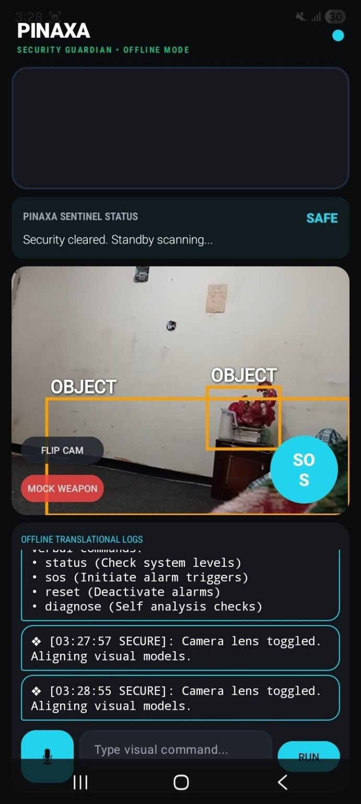
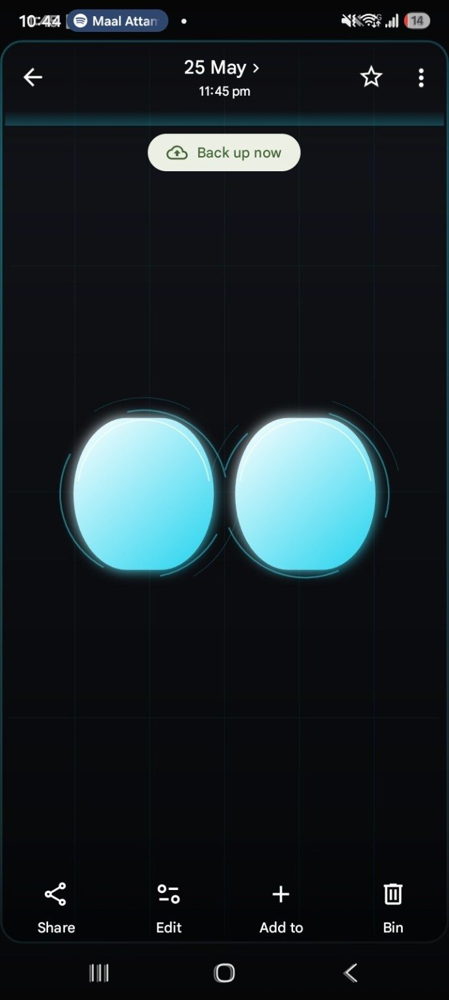
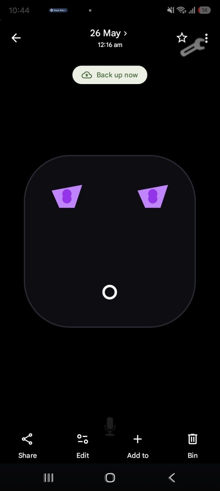
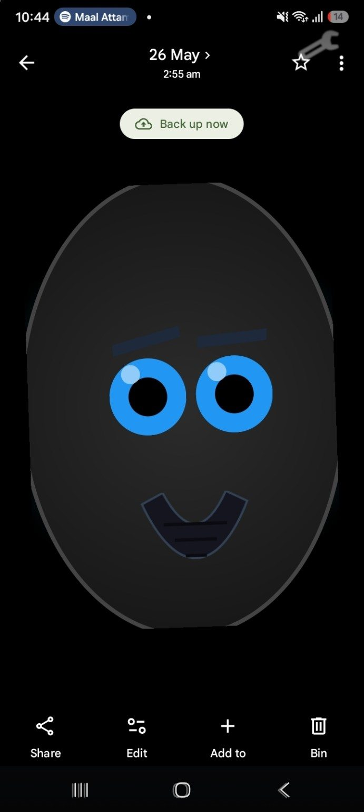
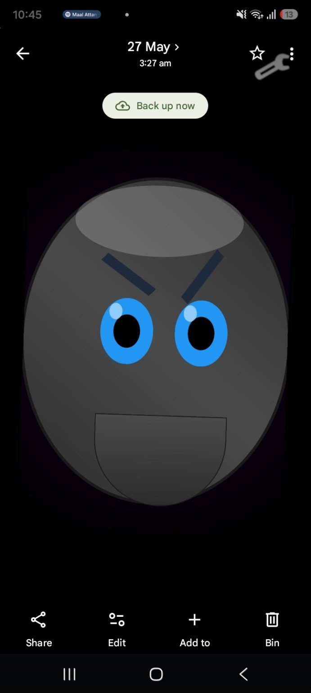
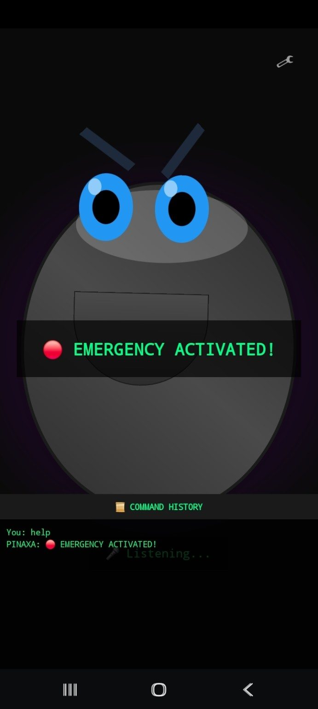
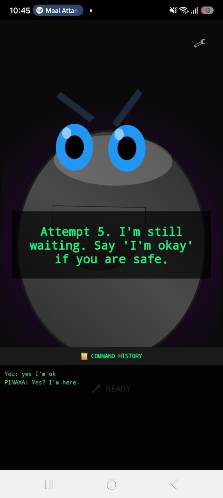
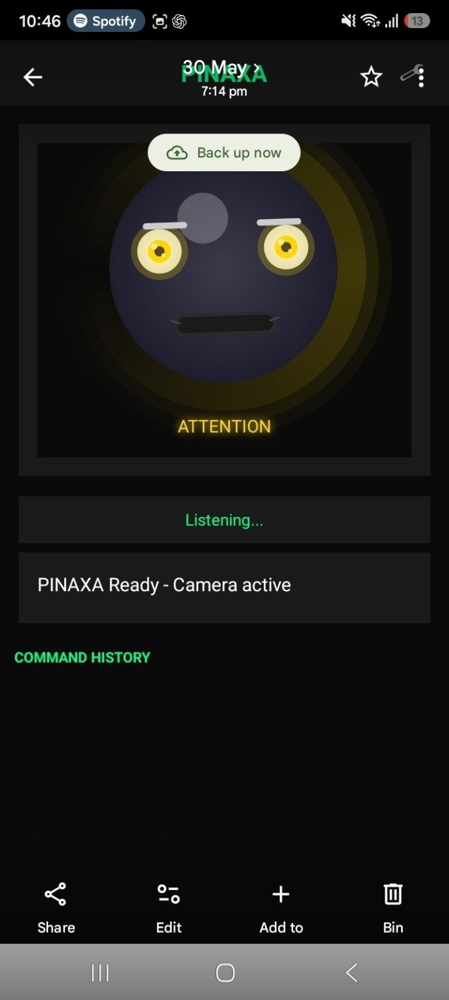
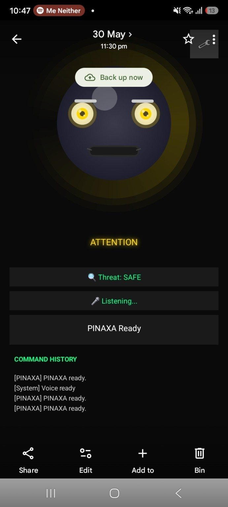
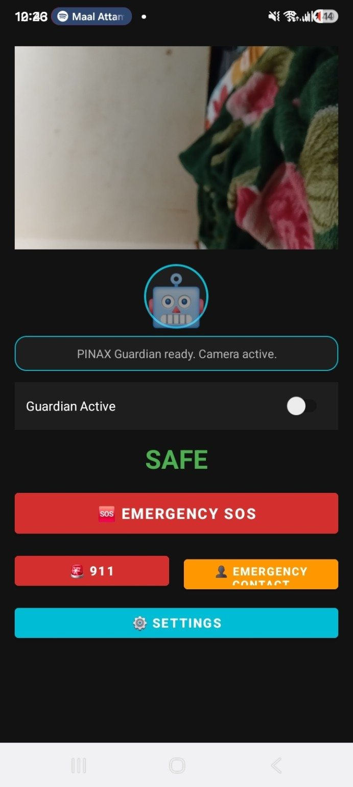

# I built my first serious Android systems on a phone.

### I'm Geda Taye. A self-taught Android and web developer from Ethiopia.

**This is not a gallery of perfect projects. It's the story of what happened while I tried to make things work.**

[**Read the visual story**](index.html) · [**See my actual projects**](#the-projects-i-built) · [**Contact me**](#lets-build-something)

---

## Before I had a product to show, I had problems to solve.

I didn't have a laptop. I wasn't sitting in an office with a development team.

I had an **Android phone**, a code editor, a lot of questions, and an idea that felt bigger than the device in my hands.

I taught myself by trying things I couldn't yet explain perfectly. I wrote code, built the APK, installed it, pressed buttons, watched the behavior, and went back to the code when it failed. Some nights I would fix one error only to find another one behind it.

The screenshots below are from those days. I kept them because they show the part of development that a finished product usually hides.

## May 2026 — PINAXA was not a simple SOS app.

I wanted to build an **AI-powered security guardian** that could use the phone's camera and microphone, respond to instructions, and help during an emergency. I didn't just sketch that idea. I built versions of it in Java, compiled Android applications, and tested interfaces on my phone.

The original project became much larger than today's PINAXA. There were camera previews, face/object overlays, voice-command screens, emergency-state messages, local logs, a robot character with changing expressions, and experiments with ML Kit and on-device models.

### May 19 — I hit the wall.

One of my build screenshots shows errors in `CameraHelper.java`: the project couldn't resolve ML Kit classes. Other captured builds show manifest theme problems and a failed `downloadThreatModel` task.

To someone viewing only the finished app, that might be invisible. To me, those errors were the work. I had to understand why dependencies, resource names and Android build tasks disagreed with my code—while doing everything on the same phone.

**I didn't learn these things because a course said I should. I learned because the app wouldn't build until I dealt with them.**

### May 25 — the guardian had a camera and a control panel.

An old version displayed a camera feed, highlighted boxes, guardian status, an SOS control and scrolling diagnostic logs. The screenshot even shows a `weapon_knife_mock` test trigger.

That detail matters: **some detections were simulated tests**, not a validated model recognizing real threats. My goal was to develop and connect the pieces of the system. Later, I would understand why simply making an alert appear was very different from making a reliable safety product.

### May 25–30 — I tried to make the guardian feel alive.

I kept drawing and rebuilding the robot's face. It wasn't only decoration. I wanted someone looking at the screen to understand whether the guardian was listening, paying attention, waiting for a reply or handling an emergency.

I experimented with **eight visible face or interaction states**. These are my original Android screenshots—not AI-generated marketing mockups.

<table>
<tr>
<td width="25%" align="center"> 01 — Glowing cyan eyes</td>
<td width="25%" align="center"> 02 — Minimal purple face</td>
<td width="25%" align="center"> 03 — Friendly blue eyes</td>
<td width="25%" align="center"> 04 — Stronger expression</td>
</tr>
<tr>
<td align="center"> 05 — Emergency activated</td>
<td align="center"> 06 — Waiting for a reply</td>
<td align="center"> 07 — Attention</td>
<td align="center"> 08 — Listening and status</td>
</tr>
</table>

The **emergency version** displayed “EMERGENCY ACTIVATED!” after a help command. Another version showed a follow-up prompt asking the user to say “I'm okay” if safe. The yellow-eyed version showed an **ATTENTION** expression, then a screen with **Listening**, **Threat: SAFE** and command history.

There were also simpler early prototypes:

The different faces weren't eight separate products. They were **eight visible experiments inside a long series of PINAXA rebuilds**.

### The original AI models — and the versions I lost

I worked on local AI model integration and remember tests functioning during development. I also deleted some local model files and lost track of a number of earlier versions. Several source ZIPs survive, but not every build or model from that period.

The remaining source records prove substantial Android implementation: camera/voice components, services, interface code and emergency workflows. They also contain incomplete or mock model paths in some revisions. I won't describe the missing models as independently verified today. **Losing an old file doesn't erase the work, but it does limit what I can demonstrate now.**

### The important decision: I made PINAXA smaller.

After building and rebuilding the ambitious guardian, I asked a harder question: *what could I make understandable and more dependable for a person who needs help?*

That led to the **current PINAXA**: a clearer personal-safety tool with a visible panic button, configurable shake-based duress protection, emergency contacts, safety timer, event timeline and password-gated evidence area.

It was not a case of failing to build the big idea and settling for a small one. **I built many versions of the big idea, then made a deliberate engineering decision to narrow the product.** Fewer moving parts made the safety workflows easier to understand, test and improve.

[**Read the deeper PINAXA development archive →**](https://github.com/geda21/PINAXA/blob/main/EVOLUTION.md)

*Safety note: the older camera overlays include simulated alerts. The surviving images and code do not prove certified threat recognition or guaranteed emergency response. Any safety feature needs real-world testing before reliance.*

---

## What came after those experiments?

### NONOX — a focus app that reached Google Play

I took the persistence I learned from those early Android experiments into a new problem: **how can someone make their own phone less distracting?**

NONOX became my native Android focus app. I built app blocking, phone-lock sessions, a Task Force focus mode, and statistics. It meant dealing with Android accessibility services, device-admin behavior and cases where background processes or restarts could interrupt the experience.

The difference was that **NONOX became an actual published Google Play app**. I could point to a real listing, not only a phone gallery.

**[Google Play](https://play.google.com/store/apps/details?id=com.nonox.app)** · **[Technical project](https://github.com/geda21/nonox-android)**

My smartphone-only development story was later covered in a [SaaS Hive founder interview](https://blog.saashive.com/post/coding-420-hours-on-a-6-inch-phone-in-a-room-with-flickering-electricity-to-build-a-focus-app). NONOX also placed **third among 52 founders** in SaaS Hive's [July 2026 Launch Sprint](https://saashive.com/monthly-launch-sprint/past).

### AgentBridge — I also tried to make a phone follow instructions

In September, I was experimenting with **AgentBridge**, an Android agent interface for multi-step tasks.

One preserved screen shows the agent attempting to navigate Fiverr, read gig statistics and record each action. Another displays a task-complete report referencing **16 impressions**. Those are the figures recorded in the test UI, not independently verified performance data.

The technical challenge was different from PINAXA and NONOX: following a sequence, noticing a changed screen, reporting what happened and handling the next step.

### JLab — I needed a workspace for all this work

As projects accumulated, I needed somewhere to keep notes, tasks, plans and files together.

I built **JLab**, a private Android workspace with projects, notes, calendars, local files and productivity insights.

This project took me into **Kotlin, Jetpack Compose and local-first app design**. Unlike PINAXA, the problem wasn't an emergency. It was the everyday challenge of organizing my own work.

### JABAA Shop — learning to build a business around software

I also built **[JABAA Shop](https://jabashop.store)**, an ebook and learning-course marketplace. That meant more than making a homepage: I worked with listings, accounts, Supabase data, order and receipt flows, local ETB purchasing and links to international checkout.

**[Live store](https://jabashop.store)** · **[Repository](https://github.com/geda21/jabashop)**

### EthioDate — accounts, discovery, messaging and premium workflows

**[EthioDate](https://ethiodate.base44.app/)** explored a different product category: public profile discovery, likes, matches, chat, authentication and premium access. It taught me about product flows that involve multiple users and more sensitive personal data.

**[Product showcase](https://github.com/geda21/Ethiodate)**

---

## What I'm actually offering clients

I'm not asking clients to hire me because I learned the names of programming languages. I want them to see **how I approach problems**: I build the thing, run it, find what breaks, investigate why, then revise it until it is useful.

| I can work on | Relevant evidence |
|---|---|
| **Native Android applications** | NONOX on Google Play; PINAXA prototypes and current safety interface |
| **Android platform features** | Accessibility, device admin, camera/voice integration experiments, lifecycle and local data |
| **Mobile-first web applications** | JABAA Shop, EthioDate |
| **Productivity systems** | JLab with Kotlin, Compose and offline-first architecture |
| **Workflow automation** | AgentBridge Android agent experiments |

I use **Java, Kotlin, Android SDK, Jetpack Compose, HTML, CSS, JavaScript, Supabase, GitHub and Netlify**. My projects vary in maturity: some are released, some are private products, and some are clearly labeled experiments.

### The line I want my work to speak for itself

> **I learned software engineering by building software. Not everything worked on the first try. That's why the finished products matter.**

---

## Let's build something.

If you need an Android app, responsive website or custom tool, I can talk through the real implementation—not just the appearance.

**[View my visual portfolio](index.html)** · **[NONOX on Google Play](https://play.google.com/store/apps/details?id=com.nonox.app)** · **[PINAXA story](https://github.com/geda21/PINAXA/blob/main/EVOLUTION.md)**

*Geda Taye · Ethiopia · Built and tested from a smartphone.*

